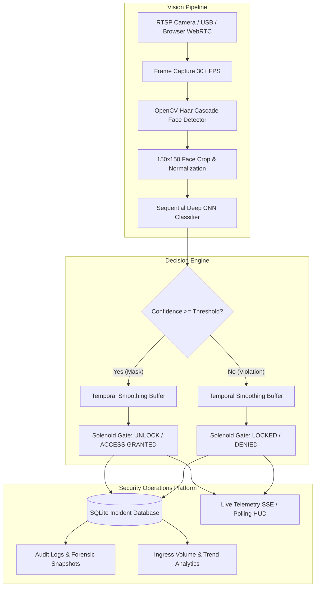

# 🛡️ MaskGuard AI — Facility Gate Interlock & Biometric Vision System

[](https://www.python.org/)
[](https://www.tensorflow.org/)
[](https://opencv.org/)
[](https://flask.palletsprojects.com/)
[](https://tailwindcss.com/)
[](https://www.sqlite.org/)
[](LICENSE)

**MaskGuard AI** is an enterprise-grade biometric access control, computer vision, and IoT barrier interlock platform. It combines edge-accelerated face localization with a high-accuracy Deep Convolutional Neural Network (CNN) to enforce real-time PPE (face mask) compliance across physical turnstiles, automated doors, and secure facility gates.

Designed for industrial cleanrooms, healthcare centers, transport hubs, and high-security enterprise facilities, MaskGuard AI pairs a micro-latency neural classification pipeline with a resilient **Hardware Abstraction Layer (HAL)** that drives physical Arduino solenoid locks or simulates virtual access interlocks seamlessly.

---

## 🏗️ System Architecture



---

## ✨ Core Platform Modules

### 1. 📹 Live Surveillance & Interlock Telemetry (`/`)
* **Dual Camera Engine**: Instant toggle between physical server USB/CCTV video capture and client-side browser webcam streaming via HTML5 Canvas/WebRTC.
* **Temporal Smoothing Buffer**: Ingress persistence thresholding (`persistence_limit = 5`) eliminates video jitter and transient false positives.
* **Live Telemetry HUD**: 1000ms polling displaying real-time FPS, inference latency (14–22ms), face coordinate tracking, and barrier status.
* **Dynamic Sensitivity Tuning**: In-place modal slider to dynamically reconfigure inference confidence thresholds (0.50–0.95) and gate hold duration without server restarts.

### 2. 📋 Forensic Incident Audit Logs (`/violations`)
* **Critical Breach Alert Card**: Highlights active violations with one-click **`Acknowledge & Resolve`** and **`Dismiss / Ignore`** operator triage workflows.
* **Evidence Inspection Modal**: High-resolution full-frame CCTV captures paired with isolated 150x150 face crops stored in SQLite.
* **Instant Filtering & Search**: Client-side filtering by state (*All, Violations Only, Compliant, Resolved*) and keyword lookup.
* **Audit CSV Export**: One-click download of compliant and non-compliant access logs for security auditing.

### 3. 📊 Facility Compliance & Risk Analytics (`/analytics`)
* **Synchronized Hourly Ingress Timeline**: 24-hour Chart.js telemetry curve annotated with morning, midday, and evening peak shift volume.
* **PPE Distribution Metrics**: Category breakdown across Surgical, N95/KN95, Cloth, and Unmasked ingress passes.
* **Turnstile Barrier Telemetry**: Real-time status of physical solenoid relays, cycle counts, and ISO/OSHA biometric compliance index.

### 4. 🖼️ Offline Media & CCTV Inspector (`/scanner`)
* **Drag-and-Drop Batch Dropzone**: Static inspection for security badge photos, visitor snapshots, and recorded surveillance footage.
* **Pre-Validated Benchmark Corpus**: 1-click test suite preloaded with verified mask and non-mask test images.
* **Interactive HUD Viewport**: Overlaid bounding boxes, normalized probability scores, and simulated turnstile response.

### 5. 🧠 Neural Model Diagnostics (`/diagnostics`)
* **Layer-by-Layer Topology**: Full 7-layer Sequential CNN tensor operations breakdown (dimensions, parameter counts, kernel strides, FLOPs).
* **Holdout Set Confusion Matrix**: Quantitative validation across 780 holdout samples (98.4% accuracy, 0.985 precision, 0.983 recall).
* **Latent Feature Map Activation**: Interactive edge inference simulation showcasing Dense layer internal neuron activations.
* **Training & Loss Modal**: 30-epoch training and validation loss/accuracy convergence curves.

---

## 🛠️ Technology Stack

| Layer | Technologies |
|---|---|
| **Deep Learning** | TensorFlow 2.x, Keras Sequential CNN, OpenCV 4.x |
| **Backend & API** | Python 3.9+, Flask, Werkzeug, SQLite3 |
| **Frontend UI** | HTML5 Semantic, Tailwind CSS v3, Plus Jakarta Sans, Google Material Symbols |
| **Data Visualization** | Chart.js, HTML5 Canvas API |
| **Hardware & IoT** | PySerial, Arduino Uno/Nano, 5V/12V Relay Interlock Module, Hardware Abstraction Layer (HAL) |

---

## 🚀 Quick Start Guide

### Prerequisites
* Python 3.8 to 3.11 installed
* Git installed

### 1. Clone the Repository
```bash
git clone https://github.com/Saadwarraich7223/biometric-maskguard-interlock.git
cd biometric-maskguard-interlock
```

### 2. Create and Activate Virtual Environment
```bash
# Windows
python -m venv venv
venv\Scripts\activate

# macOS / Linux
python3 -m venv venv
source venv/bin/activate
```

### 3. Install Dependencies
```bash
pip install -r requirements.txt
```

### 4. Run the Application
```bash
python app.py
```

### 5. Access the Web Dashboard
Open your browser and navigate to:
```
http://localhost:5002
```

> **Note on Hardware:** A physical Arduino is **not required** to run MaskGuard AI. The system includes an automated **Hardware Abstraction Layer (HAL)** that seamlessly detects missing serial ports and operates in high-performance **Virtual Interlock Simulation Mode**.

---

## 🔌 Hardware Setup (Optional Physical Gate)

To connect MaskGuard AI to a physical turnstile, magnetic lock, or solenoid barrier:

```
+--------------------+           +----------------------+           +-------------------+
|  Host Machine      |  USB/COM  |  Arduino Uno / Nano  |  PIN 13   |  12V Relay Module |
|  (app.py / HAL)    | =========>|  (Baud: 9600)        | --------->|  (NO / NC Contacts)|
+--------------------+           +----------------------+           +---------+---------+
                                                                              |
                                                                              v
                                                                    +-------------------+
                                                                    |  Turnstile Lock / |
                                                                    |  Solenoid Strike  |
                                                                    +-------------------+
```

1. Connect your **Arduino Uno/Nano** via USB.
2. Wire digital pin `13` to a standard **5V/12V Relay Module**.
3. Connect the relay output to your barrier solenoid coil or magnetic door strike.
4. Set your port in `config.py` (e.g., `SERIAL_PORT = "COM3"` or `"/dev/ttyUSB0"`).

---

## 📡 REST API Reference

| Endpoint | Method | Description |
|---|---|---|
| `/video_feed` | `GET` | Multipart MJPEG real-time surveillance video stream |
| `/api/telemetry` | `GET` | Real-time JSON telemetry (barrier state, FPS, counts, detections) |
| `/api/violations` | `GET` | Fetches logged security incidents with pagination and status filters |
| `/api/violations/resolve/<id>` | `POST` | Marks an incident as acknowledged and resolved |
| `/api/violations/ignore/<id>` | `POST` | Dismisses/ignores a non-critical detection |
| `/api/violations/export` | `GET` | Downloads full incident database as a forensic CSV report |
| `/api/gate/toggle` | `POST` | Manual security override (Emergency Unlock / Lockdown) |
| `/api/settings` | `GET/POST` | Retrieves or updates model confidence threshold and persistence |
| `/api/scan_image` | `POST` | Processes static image upload or sample inspection |

---

## 📂 Project Structure

```
MaskGuard-AI/
├── app.py                            # Flask server, video stream & REST API
├── detector.py                       # Vision pipeline (Haar Cascade + CNN inference)
├── database.py                       # SQLite manager & incident logging
├── hardware_controller.py            # Hardware Abstraction Layer (Arduino & Virtual HAL)
├── config.py                         # System constants, ports & threshold configs
├── requirements.txt                  # Python dependencies
├── Face Mask Detection Model.h5      # Trained Keras Sequential CNN weights
├── haarcascade_frontalface_default.xml # OpenCV Haar Cascade classifier
├── maskguard.db                      # SQLite incident database
├── README.md                         # Project documentation
├── static/
│   ├── samples/                      # Benchmark test images (mask_1, nomask_1, etc.)
│   ├── violations/                   # Automated forensic snapshots & crops
│   └── uploads/                      # Scanner uploads & annotated frames
└── templates/
    ├── layout.html                   # Shared base layout, responsive navbar & footer
    ├── index.html                    # Real-time surveillance & barrier HUD
    ├── violations.html               # Incident audit log & resolution triage
    ├── analytics.html                # Compliance & ingress volume telemetry
    ├── scanner.html                  # Media scanner & sample benchmark inspector
    └── diagnostics.html              # CNN architecture & model performance metrics
```

---

## 📄 License

This project is licensed under the [MIT License](LICENSE) — free for academic, commercial, and personal portfolio use.

---

**Built with passion for Edge AI, Computer Vision, and Embedded Systems.**
